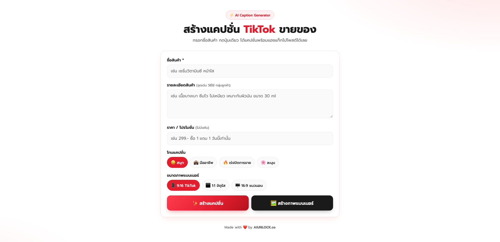
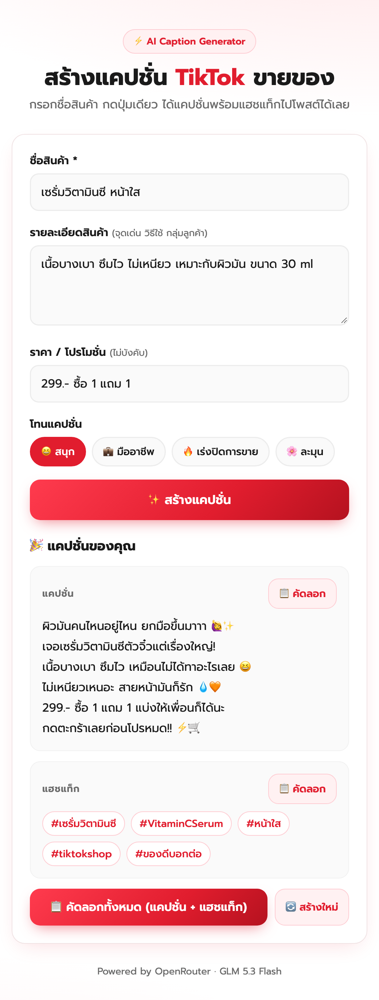
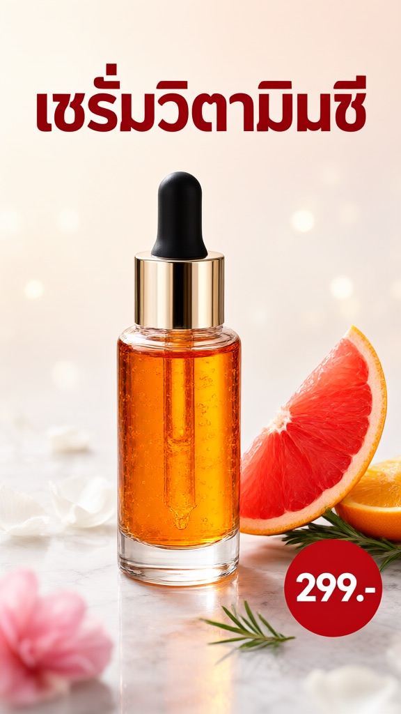

<div align="center">

# 🔴 TikTok Caption Generator

**สร้างแคปชั่น TikTok + ภาพแบนเนอร์สินค้าด้วย AI ในคลิกเดียว — พร้อมแฮชแท็ก และปุ่มคัดลอก**

เว็บแอปหน้าเดียว โทนขาว-แดง ใช้งานง่ายบนมือถือ ขับเคลื่อนด้วย **GLM 5.3 Flash** (แคปชั่น) และ **Qwen Image 2.1 Turbo** (ภาพ) ผ่าน [OpenRouter](https://openrouter.ai)




</div>

---

## ✨ ความสามารถ

| | |
|---|---|
| ✍️ **กรอกง่าย** | ใส่ชื่อสินค้า รายละเอียด และราคา/โปรโมชั่น (ไม่บังคับ) |
| 🎭 **เลือกโทนได้ 4 แบบ** | 😆 สนุก · 💼 มืออาชีพ · 🔥 เร่งปิดการขาย · 🌸 ละมุน |
| 🪝 **แคปชั่นสไตล์ TikTok** | บรรทัดแรกเป็น hook หยุดนิ้ว → จุดเด่นสินค้า → ปิดด้วย Call-to-Action |
| #️⃣ **แฮชแท็ก 5 อันพอดี** | ผสมไทย-อังกฤษ เกี่ยวกับสินค้าจริง (คุมทั้งใน prompt และฝั่ง server) |
| 🖼️ **สร้างภาพแบนเนอร์** | ภาพโฆษณาสินค้าพร้อมชื่อและราคา เลือกขนาด 9:16 / 1:1 / 16:9 แล้วดาวน์โหลดได้ |
| 📋 **คัดลอกได้ 3 แบบ** | เฉพาะแคปชั่น · เฉพาะแฮชแท็ก · ทั้งหมดในครั้งเดียว |
| 🛡️ **ปลอดภัยต่อร้านค้า** | สั่งห้ามคำโอ้อวด/การันตี เช่น 100%, หายขาด, เห็นผลทันที |
| 🔐 **API key ไม่หลุด** | key อยู่ฝั่ง server เท่านั้น เบราว์เซอร์ไม่เคยเห็น |

## 📸 ตัวอย่างผลลัพธ์

<div align="center">

&nbsp;&nbsp;

</div>

> ตัวอย่างทั้งสองเป็นผลลัพธ์จริงจากโมเดล — ซ้าย: แคปชั่นโทนสนุก · ขวา: ภาพแบนเนอร์ 9:16

## 🚀 เริ่มใช้งาน

**สิ่งที่ต้องมี:** Node.js 20.6 ขึ้นไป และ API key จาก [openrouter.ai/settings/keys](https://openrouter.ai/settings/keys)

```bash
git clone https://github.com/aiunlocked1412/tiktok-caption-generator.git
cd tiktok-caption-generator
cp .env.example .env      # แล้วใส่ OPENROUTER_API_KEY ในไฟล์ .env
npm start
```

เปิด **http://localhost:3000** — เสร็จ! ไม่ต้อง `npm install` เพราะไม่มี dependency เลย

## ⚙️ ตั้งค่า (`.env`)

| ตัวแปร | จำเป็น | ค่าเริ่มต้น | คำอธิบาย |
|---|---|---|---|
| `OPENROUTER_API_KEY` | ✅ | – | API key ของ OpenRouter |
| `OPENROUTER_MODEL` | | `z-ai/glm-5.3-flash` | โมเดลสร้างแคปชั่น |
| `OPENROUTER_IMAGE_MODEL` | | `qwen/qwen-image-2.1-turbo` | โมเดลสร้างภาพแบนเนอร์ |
| `PORT` | | `3000` | พอร์ตของ server |

## 🧩 โครงสร้างโปรเจกต์

```
├── public/index.html   # หน้าเว็บ (HTML + CSS + JS ไฟล์เดียว)
├── server.js           # เสิร์ฟหน้าเว็บ + proxy เรียก OpenRouter
├── .env.example        # ตัวอย่างไฟล์ตั้งค่า
└── screenshot/         # ภาพประกอบ README
```

**การทำงาน:**
- แคปชั่น: เบราว์เซอร์ → `POST /api/generate` → `server.js` เรียก Chat Completions → แยก JSON `{caption, hashtags}` → แสดงผล
- ภาพ: เบราว์เซอร์ → `POST /api/image` → `server.js` เรียก `/api/v1/images` → ส่งภาพกลับเป็น base64 → แสดงผล + ดาวน์โหลด

### ปรับแต่ง prompt

แก้ได้ใน `server.js`:
- `SYSTEM_PROMPT` — กติกาการเขียนแคปชั่น
- `TONES` — คำอธิบายของแต่ละโทน
- `MAX_TAGS` — จำนวนแฮชแท็กสูงสุด (ถ้าแก้ อย่าลืมแก้ตัวเลขใน prompt ให้ตรงกัน)
- `bannerPrompt()` — prompt ของภาพแบนเนอร์ (คุมให้มีเฉพาะชื่อสินค้าและราคา ห้ามโลโก้)

แก้แล้วรีสตาร์ท server (`npm start`) เพื่อให้มีผล

## ⚠️ ข้อควรรู้

- ข้อความจาก AI อาจมีคำพิมพ์ผิดหรือเติมคุณสมบัติที่ไม่ได้กรอก — **อ่านทวนก่อนโพสต์ทุกครั้ง**
- ภาพแบนเนอร์บางครั้งสะกดข้อความไทยผิด — ถ้าเจอ กด “สร้างภาพใหม่” ได้เลย (ชื่อสินค้าสั้น ๆ จะได้ผลดีกว่า)
- ค่าใช้จ่าย: แคปชั่นระดับเศษสตางค์ต่อครั้ง · ภาพประมาณ $0.018 ต่อภาพ (ใช้เวลา ~15 วินาที) ดูราคาล่าสุดที่หน้าโมเดล [GLM 5.3 Flash](https://openrouter.ai/z-ai/glm-5.3-flash) · [Qwen Image 2.1 Turbo](https://openrouter.ai/qwen/qwen-image-2.1-turbo)
- ห้าม commit ไฟล์ `.env` — ตั้งไว้ใน `.gitignore` แล้ว

---

<div align="center">
Made with ❤️ by <b>AIUNLOCK.co</b>
</div>
